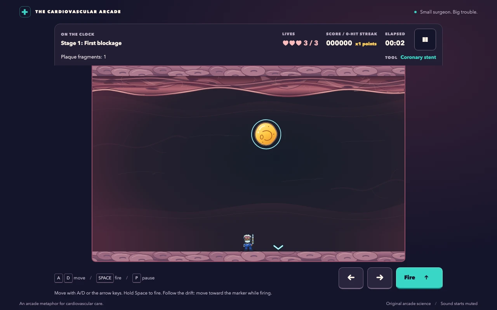

# Plaque Attack

A browser arcade game for gamers and biology enthusiasts: choose one of six surgeons, split floating plaque, and restore a patient's recovery map across 24 artery-themed stages.

**[Play Plaque Attack in your browser](https://vosslab.github.io/plaque-attack/)**
No installation or account required. Bring your arcade reflexes; the biology is optional.
The gallery shows the surgeon cast, campaign play, tissue carving and recovery map. Select an
image to open it at full size.
[docs/SCREENSHOTS.md](docs/SCREENSHOTS.md) records capture provenance and refresh status.

<!-- screenshots:begin (managed by screenshot-docs) -->

| First-run surgeon choice | First-stage gameplay |
| --- | --- |
| [](docs/screenshots/surgeon_roster.webp) | [](docs/screenshots/art_identity_game.webp) |
| Stage 4 tissue carving | Patient recovery |
| [](docs/screenshots/tissue_carving.webp) | [](docs/screenshots/patient_recovery.webp) |

<!-- screenshots:end -->

Recovery progress in the screenshot is a demonstration save. See the
[gameplay-size surgeon lineup](docs/screenshots/art_identity_roster.webp) for movement,
celebration, grayscale and silhouette views of all six characters.

## The game

Plaque Attack turns a floating-hazard arcade loop into a colorful cardiovascular adventure. Move a
cartoon surgeon along the artery, fire upward, and make room for the smaller hazards created as large
plaques split. Short captions provide optional biology context; no medical knowledge is required.

The campaign introduces all three tools in its first three displays, then gives players room to
practice and combine their established mechanics:

| Levels | Tools | Goal |
| --- | --- | --- |
| 1-6: First Response | Stent, aspirin, then clopidogrel | Meet all three tools, then practice sticky, heavy and unstable plaque |
| 7-12: Platelet Pop | Aspirin mastery | Practice currents, shelter and finite clears before a three-group finale |
| 13-18: Pulse Partners | Clopidogrel and dual-tool mastery | Combine persistent shots, gathering and piercing before a lining finale |
| 19-24: Flow State | Alternating aspirin and clopidogrel | Alternate maintenance with finite breathers, then restore the rhythm |

- Carve tissue shelter with any shot, or use an open lane; hazards also erode cover on contact.
- Follow sloping floors automatically; shoot switches to gather hazards into a firing lane.
- Discover optional support, carve its shell and walk over to collect a one-contact shield.
- Clear four finite chapter finales with different groups and visible restoration.
- Carry three lives between clears; retry a failed stage quickly with its entry score and fresh lives.
- Track retries fairly in remix records while keeping historical scores in separate editions.
- Practice unlocked levels with fresh lives and an unranked score; use keyboard or touch controls.
- Choose among six original surgeon portraits with the same movement, collision, and weapons.
- Restore coronary routes after campaign clears and watch the patient become more active.
- Keep selection, recovery, unlocks and scores locally; sound starts muted and motion follows your preference.

All 24 remixed stages are authored. The unchanged first display remains a gentle stent introduction;
stages 2 and 3 introduce aspirin and clopidogrel before later mastery and combination play.
Shootable currents last four seconds and share a six-second cooldown. Support is optional,
nonstacking and protects against one contact; overload still requires reducing hazards.
The four finales restore the artery opening, flow, lining and patient activity in distinct ways.
Current checks and remaining integrated acceptance are tracked in
[docs/active_plans/reports/remix_execution_ledger.md](docs/active_plans/reports/remix_execution_ledger.md).
Older completion runs describe earlier snapshots; automated reachability does not prove enjoyment.

The tools are arcade metaphors: real stents support narrowed arteries, and antiplatelet drugs reduce
platelet activity and clot formation. The recovery illustration is an arcade story payoff, not a clinical treatment model. Its drugs
do not remove cholesterol plaque. Tissue carving and plaque merging are arcade abstractions. See [docs/GAME_SPEC.md](docs/GAME_SPEC.md) for the biology framing.

## Quick start

Open [the live game](https://vosslab.github.io/plaque-attack/), choose **Play campaign**, then
**Start stage**. Move with the arrow keys or A/D and hold Space to fire; touch controls are also
available. Split the floating plaque and clear its fragments to finish the first stage.

### Run locally

Use Node.js 24 or newer, npm, and Python 3 for the local preview server. From the repository root:

```bash
./devel/setup_typescript.sh
source source_me.sh
./run_web_server.sh
```

Open the localhost address printed by the script. On your first visit, pick a surgeon and press
**Continue**, then choose **Play campaign** and **Start stage**. Your choice is remembered;
use **Choose surgeon** whenever you want a different teammate.
After the countdown, move out from beneath a drifting plaque and hold Space to fire. A successful
hit splits larger plaque; clear the fragments to finish level 1. Watch the last pop and a brief
surgeon celebration, then press Enter or freshly press Space to continue to the next briefing.
Use a separate press to start that level. Newly restored routes appear in the result; **Patient
recovery** opens the map when you want it. Map stage buttons start unranked practice; practice
never earns recovery.

The preview builds and serves `dist/`, choosing a random port unless `PORT` is set. Stop it with
Ctrl+C. To produce the static site without starting a server:

```bash
./build_github_pages.sh
```

The build type-checks the application and writes HTML, CSS, JavaScript, and original SVG assets to
`dist/`. For hosting, follow [docs/GITHUB_SETUP.md](docs/GITHUB_SETUP.md).

## Controls

| Input | Action |
| --- | --- |
| Left/right arrows or A/D | Move |
| Space, held if desired | Fire at the equipped tool's allowed rate |
| Enter or a fresh Space press | Start from a briefing or activate the result's continue/retry action |
| P or Escape during play | Pause |
| Tab, then Enter | Focus and activate menu buttons |
| On-screen left, right, and fire buttons | Touch play |

Release the fire key before using Space to continue. Each screen needs its own deliberate press;
holding a key through a clear cannot skip results or start the next level. Shortcuts yield to
dialogs and focused controls; Tab and native button activation remain available.

Pause also provides help, settings, and a return to the menu. Watch the HUD for your current goal:
early rounds show elapsed time, while maintenance rounds show time remaining and the active-hazard
limit. An overload warning gives you time to bring the count back down before losing a life.

## Documentation

- [docs/GAME_SPEC.md](docs/GAME_SPEC.md) describes the campaign, controls, educational framing, accessibility, and acceptance criteria.
- [docs/GITHUB_SETUP.md](docs/GITHUB_SETUP.md) explains how the static `dist/` build fits GitHub Pages setup.
- [docs/PLAYWRIGHT_USAGE.md](docs/PLAYWRIGHT_USAGE.md) explains browser-test setup and execution.
- [docs/SCREENSHOTS.md](docs/SCREENSHOTS.md) explains the repeatable WebP screenshot refresh and demonstration states.
- [docs/archive/remix_campaign_plan.md](docs/archive/remix_campaign_plan.md) defines the current campaign, retry and record contracts.
- [docs/EXPANSION_PLAN.md](docs/EXPANSION_PLAN.md) preserves the historical expansion matrix.
- [docs/RECOVERY_ROSTER_PLAN.md](docs/RECOVERY_ROSTER_PLAN.md) records the roster and recovery contract.
- [docs/DIFFICULTY_RUBRIC.md](docs/DIFFICULTY_RUBRIC.md) explains the challenge curve and tool-introduction resets.
- [docs/active_plans/active/organic_expansion.md](docs/active_plans/active/organic_expansion.md) records the completed expansion and acceptance status.

## License

Source code: [LICENSE.MIT](LICENSE.MIT).
