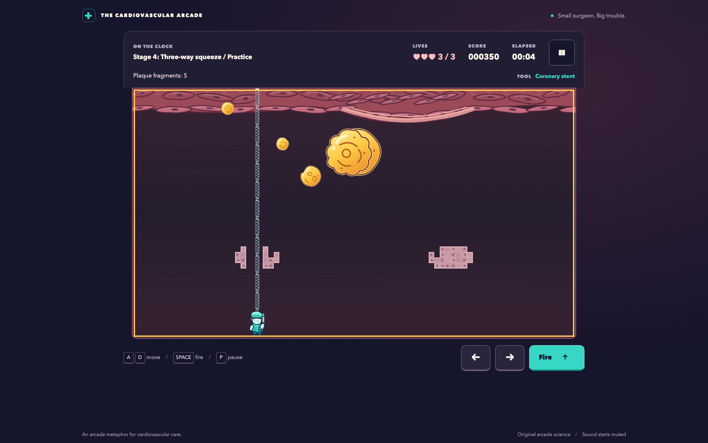

# plaque-attack

A browser arcade game for gamers and biology enthusiasts: split floating plaque, dodge platelet hazards, and carve firing lanes through tissue across 24 artery-themed stages.

**[Play Plaque Trouble in your browser](https://vosslab.github.io/plaque-attack/)**
No installation or account required. Bring your arcade reflexes; the biology is optional.

<!-- screenshots:begin (managed by screenshot-docs) -->


<!-- screenshots:end -->

## The game

Plaque Trouble turns a floating-hazard arcade loop into a colorful cardiovascular adventure. Move a
cartoon surgeon along the artery, fire upward, and make room for the smaller hazards created as large
plaques split. Short captions provide optional biology context; no medical knowledge is required.

The campaign changes the goal as you progress:

| Levels | Tools | Goal |
| --- | --- | --- |
| 1-6: Plaque Patrol | Stent | Split plaque, starting with three deliberately gentle rounds |
| 7-12: Platelet Pop | Aspirin | Clear platelet hazards arriving in changing patterns |
| 13-18: Pulse Partners | Clopidogrel, then alternating shots | Time persistent shots, then try a short maintenance round |
| 19-24: Flow State | Alternating aspirin and clopidogrel | Maintain a safe hazard count through 40-60-second rounds |

- Carve tissue shelter with any shot, or use an open lane; hazards also erode cover on contact.
- Follow the sloping floor automatically, and choose whether to open optional membrane pockets.
- Carry three lives through the campaign, earning hit, completion, and no-damage bonuses.
- Practice unlocked levels with fresh lives and an unranked score.
- Use keyboard or touch controls. Sound starts muted; animation follows your reduced-motion preference.
- Keep unlocked levels, settings, and high scores in this browser's local storage.

The integrated 24-stage campaign has an automated completion trace and independent replay,
plus separate optional-pocket practice/replay. [docs/MECHANICS_ACCEPTANCE.md](docs/MECHANICS_ACCEPTANCE.md)
records the browser, responsive, accessibility and performance evidence and its limits.
Automated reachability and optional human feedback about fun remain distinct.

The tools are arcade metaphors: real stents support narrowed arteries, and antiplatelet drugs reduce
platelet activity and clot formation. The game does not model a patient's treatment, and its drugs do
not remove cholesterol plaque. Tissue carving and plaque merging are arcade abstractions. See [docs/GAME_SPEC.md](docs/GAME_SPEC.md) for the biology framing.

## Quick start

Open [the live game](https://vosslab.github.io/plaque-attack/), choose **Play campaign**, then
**Start level**. Move with the arrow keys or A/D and hold Space to fire; touch controls are also
available. Split the floating plaque and clear its fragments to finish the first stage.

### Run locally

Use Node.js 24 or newer, npm, and Python 3 for the local preview server. From the repository root:

```bash
./devel/setup_typescript.sh
source source_me.sh
./run_web_server.sh
```

Open the localhost address printed by the script. Choose **Play campaign**, then **Start level**.
After the countdown, move out from beneath a drifting plaque and hold Space to fire. A successful
hit splits larger plaque; clear the fragments to finish level 1. Use **Continue** to advance.

The preview builds and serves `dist/`, choosing a random port unless `PORT` is set. Stop it with
Ctrl+C. To produce the static site without starting a server:

```bash
./build_github_pages.sh
```

The build type-checks the application and writes HTML, CSS, JavaScript, and original SVG assets to
`dist/`. For hosting, follow [docs/GITHUB_SETUP.md](docs/GITHUB_SETUP.md).

## Controls

| Input | Action |
| --- | --- |
| Left/right arrows or A/D | Move |
| Space, held if desired | Fire at the equipped tool's allowed rate |
| P or Escape during play | Pause |
| Tab, then Enter | Focus and activate menu buttons |
| On-screen left, right, and fire buttons | Touch play |

Pause also provides help, settings, and a return to the menu. Watch the HUD for your current goal:
early rounds show elapsed time, while maintenance rounds show time remaining and the active-hazard
limit. An overload warning gives you time to bring the count back down before losing a life.

## Documentation

- [docs/GAME_SPEC.md](docs/GAME_SPEC.md) describes the campaign, controls, educational framing, accessibility, and acceptance criteria.
- [docs/GITHUB_SETUP.md](docs/GITHUB_SETUP.md) explains how the static `dist/` build fits GitHub Pages setup.
- [docs/PLAYWRIGHT_USAGE.md](docs/PLAYWRIGHT_USAGE.md) explains browser-test setup and execution.
- [docs/EXPANSION_PLAN.md](docs/EXPANSION_PLAN.md) defines the ordered 24-stage campaign and stable level identities.
- [docs/DIFFICULTY_RUBRIC.md](docs/DIFFICULTY_RUBRIC.md) explains the challenge curve and tool-introduction resets.
- [docs/active_plans/active/organic_expansion.md](docs/active_plans/active/organic_expansion.md) records the completed expansion and acceptance status.

## License

Source code: [LICENSE.MIT](LICENSE.MIT).
