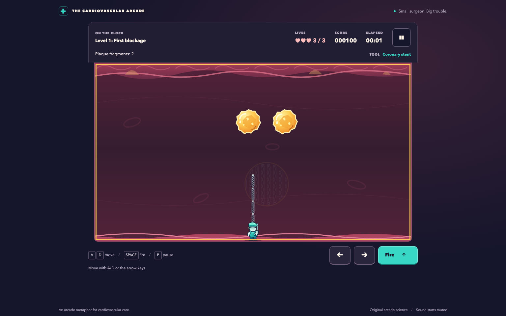

# plaque-attack

Browser arcade game for casual players and biology learners: dodge bouncing hazards through 15 artery-themed levels, switching from plaque-splitting stents to antiplatelet tools and timed maintenance.

**Playable locally.** All 15 levels are implemented. Production build, automated checks, and final
acceptance reviews pass. No public deployment has been confirmed.

<!-- screenshots:begin (managed by screenshot-docs) -->


<!-- screenshots:end -->

## The game

Plaque Trouble turns a bouncing-hazard arcade loop into a colorful cardiovascular adventure. Move a
cartoon surgeon along the artery, fire upward, and make room for the faster hazards created as large
plaques split. Short captions provide optional biology context; no medical knowledge is required.

The campaign changes the goal as you progress:

| Levels | Tools | Goal |
| --- | --- | --- |
| 1-5: Coronary intervention | Stent | Split plaque into smaller fragments, then clear them |
| 6-10: Pharmaceutical treatment | Aspirin, clopidogrel, then alternating shots | Control platelet hazards and learn the overload rule |
| 11-15: Long-term maintenance | Alternating aspirin and clopidogrel | Survive timed rounds while keeping active hazards below the overload limit |

- Carry three lives through the campaign, earning hit, completion, and no-damage bonuses.
- Practice unlocked levels with fresh lives and an unranked score.
- Use keyboard or touch controls. Sound starts muted; animation follows your reduced-motion preference.
- Keep unlocked levels, settings, and high scores in this browser's local storage.

An automated movement-and-fire trace completed all 15 levels and passed an independent replay.
That demonstrates mechanical reachability; human difficulty and balance still need playtesting.
The [docs/active_plans/active/game_implementation.md](docs/active_plans/active/game_implementation.md)
ledger records completed verification and acceptance evidence.

The tools are arcade metaphors: real stents support narrowed arteries, and antiplatelet drugs reduce
platelet activity and clot formation. The game does not model a patient's treatment, and its drugs do
not remove cholesterol plaque. See [docs/GAME_SPEC.md](docs/GAME_SPEC.md) for the biology framing.

## Quick start

Use Node.js 24 or newer, npm, and Python 3 for the local preview server. From the repository root:

```bash
./devel/setup_typescript.sh
source source_me.sh
./run_web_server.sh
```

Open the localhost address printed by the script. Choose **Play campaign**, then **Start level**.
After the countdown, move out from beneath a bouncing plaque and hold Space to fire. A successful
hit splits larger plaque; clear the fragments to finish level 1. Use **Continue** to advance.

The preview builds and serves `dist/`, choosing a random port unless `PORT` is set. Stop it with
Ctrl+C. To produce the static site without starting a server:

```bash
./build_github_pages.sh
```

The build type-checks the application and writes HTML, CSS, JavaScript, and original SVG assets to
`dist/`. For hosting, follow [docs/GITHUB_SETUP.md](docs/GITHUB_SETUP.md).

## Controls

| Input | Action |
| --- | --- |
| Left/right arrows or A/D | Move |
| Space, held if desired | Fire at the equipped tool's allowed rate |
| P or Escape during play | Pause |
| Tab, then Enter | Focus and activate menu buttons |
| On-screen left, right, and fire buttons | Touch play |

Pause also provides help, settings, and a return to the menu. Watch the HUD for your current goal:
early rounds show elapsed time, while maintenance rounds show time remaining and the active-hazard
limit. An overload warning gives you time to bring the count back down before losing a life.

## Documentation

- [docs/GAME_SPEC.md](docs/GAME_SPEC.md) describes the campaign, controls, educational framing, accessibility, and acceptance criteria.
- [docs/GITHUB_SETUP.md](docs/GITHUB_SETUP.md) explains how the static `dist/` build fits GitHub Pages setup.
- [docs/PLAYWRIGHT_USAGE.md](docs/PLAYWRIGHT_USAGE.md) explains browser-test setup and execution.
- [docs/active_plans/active/game_implementation.md](docs/active_plans/active/game_implementation.md) records implementation and acceptance evidence.

## License

Source code: [LICENSE.MIT](LICENSE.MIT).
