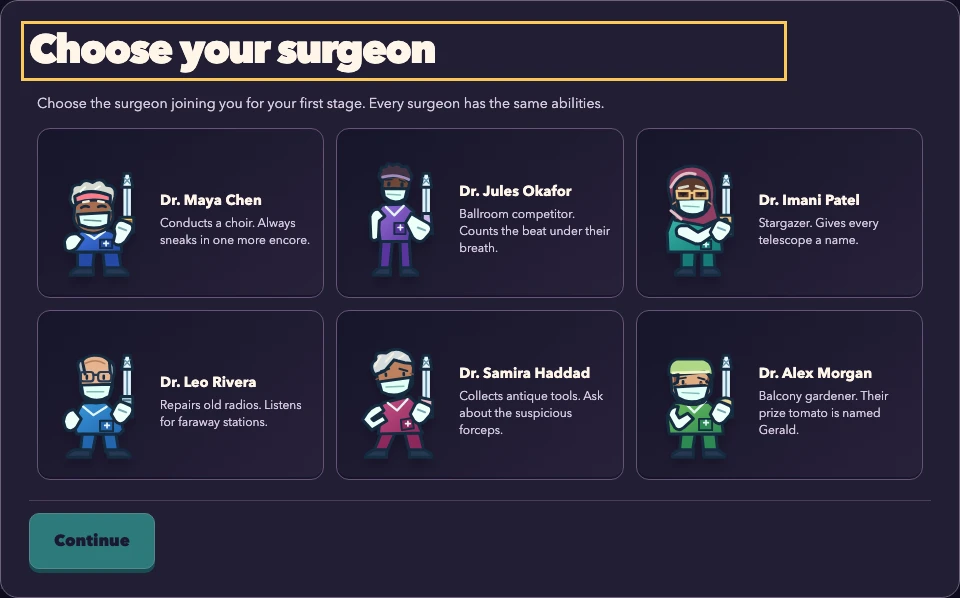
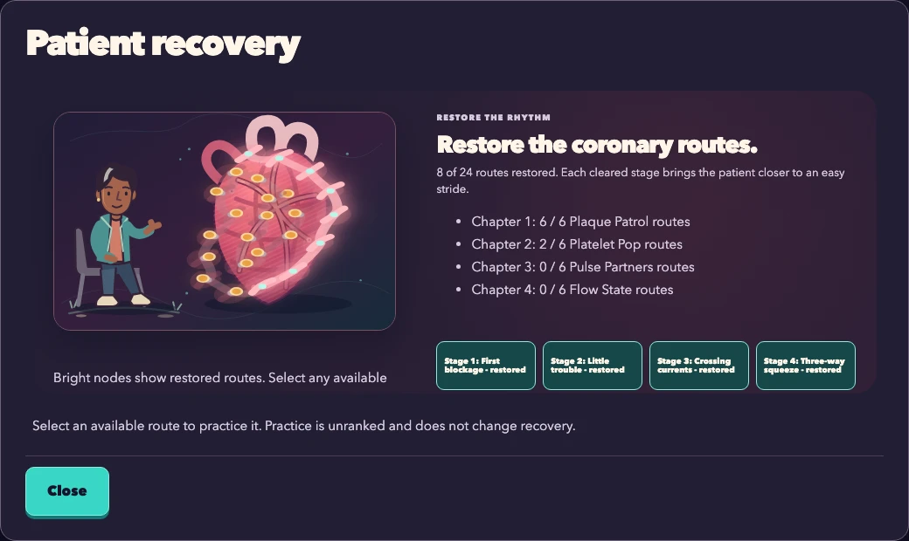
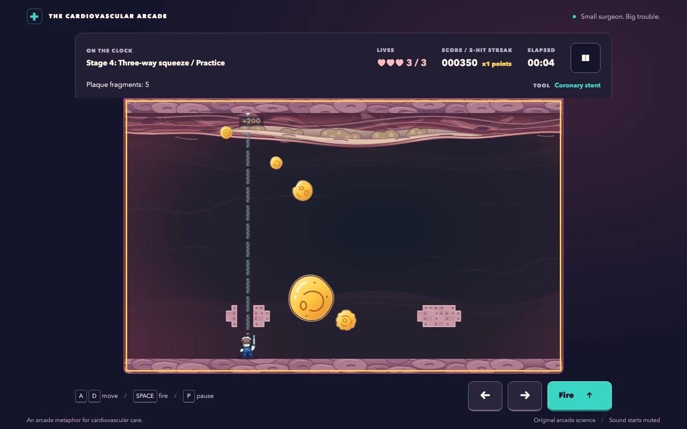

# Plaque Attack

A browser arcade game for gamers and biology enthusiasts: choose one of six surgeons, split floating plaque, and restore a patient's recovery map across 24 artery-themed stages.

**[Play Plaque Attack in your browser](https://vosslab.github.io/plaque-attack/)**
No installation or account required. Bring your arcade reflexes; the biology is optional.
The screenshots below show the current game, including the redesigned surgeon cast.

<!-- screenshots:begin (managed by screenshot-docs) -->



<!-- screenshots:end -->

Recovery progress in the screenshot is a demonstration save. See the
[gameplay-size surgeon lineup](docs/screenshots/art_identity_roster.webp) for movement,
celebration, grayscale and silhouette views of all six characters.

## The game

Plaque Attack turns a floating-hazard arcade loop into a colorful cardiovascular adventure. Move a
cartoon surgeon along the artery, fire upward, and make room for the smaller hazards created as large
plaques split. Short captions provide optional biology context; no medical knowledge is required.

The campaign changes the goal as you progress:

| Levels | Tools | Goal |
| --- | --- | --- |
| 1-6: Plaque Patrol | Stent | Split plaque, starting with three deliberately gentle rounds |
| 7-12: Platelet Pop | Aspirin | Clear platelet hazards arriving in changing patterns |
| 13-18: Pulse Partners | Clopidogrel, then alternating shots | Time persistent shots, then try a short maintenance round |
| 19-24: Flow State | Alternating aspirin and clopidogrel | Maintain a safe hazard count through 40-60-second rounds |

- Carve tissue shelter with any shot, or use an open lane; hazards also erode cover on contact.
- Follow the sloping floor automatically, and choose whether to open optional membrane pockets.
- Carry three lives through the campaign, earning hit, completion, and no-damage bonuses.
- Practice unlocked levels with fresh lives and an unranked score; use keyboard or touch controls.
- Choose among six original surgeon portraits with the same movement, collision, and weapons.
- Restore coronary routes after campaign clears and watch the patient become more active.
- Keep selection, recovery, unlocks and scores locally; sound starts muted and motion follows your preference.

The opening six stages now progress through 7, 10, 15, 25, 37, and 60 mandatory plaque hits,
with slower drift before the chapter finale. The current six-stage assisted run cleared all six
with three lives and no damage. [docs/RECOVERY_ROSTER_ACCEPTANCE.md](docs/RECOVERY_ROSTER_ACCEPTANCE.md)
records this delivery's verification and limits. The earlier full-campaign completion/replay in
[docs/MECHANICS_ACCEPTANCE.md](docs/MECHANICS_ACCEPTANCE.md) predates this tuning. Automated
reachability does not establish human enjoyment.

The tools are arcade metaphors: real stents support narrowed arteries, and antiplatelet drugs reduce
platelet activity and clot formation. The recovery illustration is an arcade story payoff, not a clinical treatment model. Its drugs
do not remove cholesterol plaque. Tissue carving and plaque merging are arcade abstractions. See [docs/GAME_SPEC.md](docs/GAME_SPEC.md) for the biology framing.

## Quick start

Open [the live game](https://vosslab.github.io/plaque-attack/), choose **Play campaign**, then
**Start stage**. Move with the arrow keys or A/D and hold Space to fire; touch controls are also
available. Split the floating plaque and clear its fragments to finish the first stage.

### Run locally

Use Node.js 24 or newer, npm, and Python 3 for the local preview server. From the repository root:

```bash
./devel/setup_typescript.sh
source source_me.sh
./run_web_server.sh
```

Open the localhost address printed by the script. On your first visit, pick a surgeon and press
**Continue**, then choose **Play campaign** and **Start stage**. Your choice is remembered;
use **Choose surgeon** whenever you want a different teammate.
After the countdown, move out from beneath a drifting plaque and hold Space to fire. A successful
hit splits larger plaque; clear the fragments to finish level 1. Watch the last pop and a brief
surgeon celebration, then press Enter or freshly press Space to continue to the next briefing.
Use a separate press to start that level. Newly restored routes appear in the result; **Patient
recovery** opens the map when you want it. Map stage buttons start unranked practice; practice
never earns recovery.

The preview builds and serves `dist/`, choosing a random port unless `PORT` is set. Stop it with
Ctrl+C. To produce the static site without starting a server:

```bash
./build_github_pages.sh
```

The build type-checks the application and writes HTML, CSS, JavaScript, and original SVG assets to
`dist/`. For hosting, follow [docs/GITHUB_SETUP.md](docs/GITHUB_SETUP.md).

## Controls

| Input | Action |
| --- | --- |
| Left/right arrows or A/D | Move |
| Space, held if desired | Fire at the equipped tool's allowed rate |
| Enter or a fresh Space press | Start from a briefing or activate the result's continue/retry action |
| P or Escape during play | Pause |
| Tab, then Enter | Focus and activate menu buttons |
| On-screen left, right, and fire buttons | Touch play |

Release the fire key before using Space to continue. Each screen needs its own deliberate press;
holding a key through a clear cannot skip results or start the next level. Shortcuts yield to
dialogs and focused controls; Tab and native button activation remain available.

Pause also provides help, settings, and a return to the menu. Watch the HUD for your current goal:
early rounds show elapsed time, while maintenance rounds show time remaining and the active-hazard
limit. An overload warning gives you time to bring the count back down before losing a life.

## Documentation

- [docs/GAME_SPEC.md](docs/GAME_SPEC.md) describes the campaign, controls, educational framing, accessibility, and acceptance criteria.
- [docs/GITHUB_SETUP.md](docs/GITHUB_SETUP.md) explains how the static `dist/` build fits GitHub Pages setup.
- [docs/PLAYWRIGHT_USAGE.md](docs/PLAYWRIGHT_USAGE.md) explains browser-test setup and execution.
- [docs/SCREENSHOTS.md](docs/SCREENSHOTS.md) explains the repeatable WebP screenshot refresh and demonstration states.
- [docs/EXPANSION_PLAN.md](docs/EXPANSION_PLAN.md) defines the ordered 24-stage campaign and stable level identities.
- [docs/RECOVERY_ROSTER_PLAN.md](docs/RECOVERY_ROSTER_PLAN.md) records the roster and recovery contract.
- [docs/DIFFICULTY_RUBRIC.md](docs/DIFFICULTY_RUBRIC.md) explains the challenge curve and tool-introduction resets.
- [docs/active_plans/active/organic_expansion.md](docs/active_plans/active/organic_expansion.md) records the completed expansion and acceptance status.

## License

Source code: [LICENSE.MIT](LICENSE.MIT).
