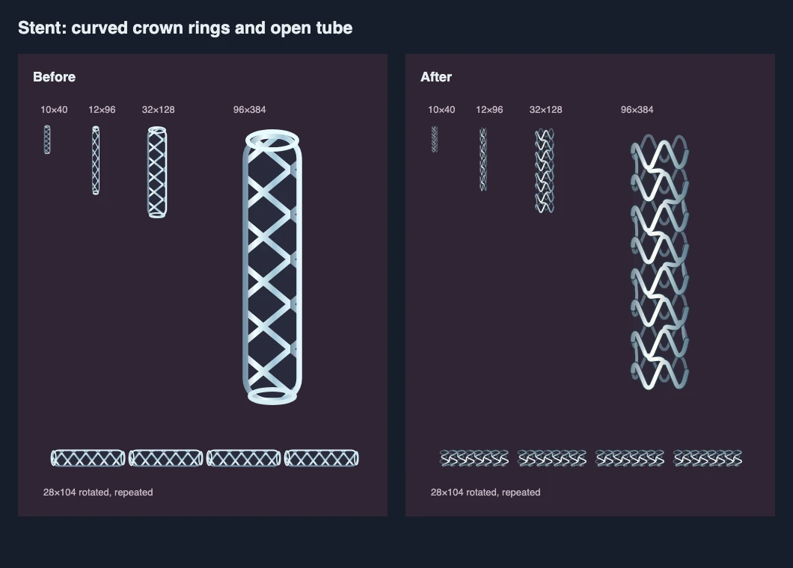
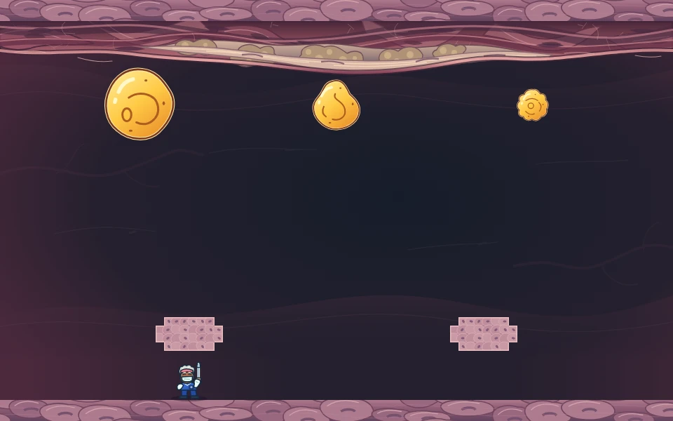

# Plaque Attack art direction

## Remix devices and restoration

The current remix preserves the established six-surgeon cast and chunky arcade style. The
editable sources [flow_switch.svg](../src/assets/flow_switch.svg),
[support_capsule.svg](../src/assets/support_capsule.svg) and
[restored_flow.svg](../src/assets/restored_flow.svg) add fictional devices and restoration.
They are required preloaded images, with semantic groups, local paints and standalone accessible
titles/descriptions. Canvas owns their live state cues.

The switch uses a plum diamond housing, lateral vanes and a pale circular hit body at 48 logical
pixels. Solid ready rings, dashed cooling rings, arrows, lane boundaries and text communicate
ready/active/cooldown states. The support capsule draws at 26 logical pixels with a pill body
and shield/check silhouette, distinct from platelet hazards and hazard-pocket shells. The
surgeon's armed shield is a static outline; absorption receives a separate brief cue.

Keep the hazard field quiet. Bounded, event-driven feedback distinguishes carving, split sizes,
current activation, capsule release/collection, shield absorption, named groups and same-projectile
multi-hit. Coalesce repeated nearby carving labels. Audio follows the same real consequences,
starts muted and respects pause and voice limits. Reduced motion keeps labels and earned shapes
while removing decorative movement; paused play freezes presentation clocks.

The transparent 960x540 restoration source supplies broad pearl/rose currents and smooth lining.
`src/remix_rendering.ts` clips it into four distinct consequences of cleared groups: a widening
artery fissure, continuous restored flow, a gathered column with floor-following lining, and a
widening final fan with the established patient/surgeon payoff. Reveal only actually earned
restoration, including partial progress on failure. These fictional arcade images make no new
claim about cardiovascular treatment or cure.

Standalone asset inspection and focused renderer probes are recorded in
[active_plans/reports/remix_assets.md](active_plans/reports/remix_assets.md) and
[active_plans/reports/remix_renderer.md](active_plans/reports/remix_renderer.md). They do not
establish integrated action readability or current campaign acceptance. The current rendered,
responsive and actual-input proof belongs to
[active_plans/reports/remix_execution_ledger.md](active_plans/reports/remix_execution_ledger.md).
[SCREENSHOTS.md](SCREENSHOTS.md) owns managed image provenance. All earlier verification sections
below describe their named historical snapshots, not acceptance of this remix.

## Scientist-inspired ensemble

Build a tangible, playful illustrated world with six memorable surgeon personalities, artery
settings that feel like places, and a patient whose recovery feels earned. Preserve clear
silhouettes at gameplay size and enough quiet space to read targets, shots and warnings.
Use shape, posture, expression, material and light to establish identity. Preserve the current
chunky arcade style the user calls pixel art: bold contours, simple masses and readable small
figures. The editable implementation remains SVG rendered through Canvas.

This revision develops the twelve base/victory surgeon SVGs, their personal descriptions and
cosmetic rhythms. Existing viewBoxes, feet/tool anchors, collision geometry and semantic IDs
remain the runtime contracts. Character choice stays cosmetic. The established artery scenes
and cardiac recovery composition provide the setting.

At the actual 44x60 gameplay size, height, body mass, face, hair, posture and accessories must
separate the cast through grayscale and solid silhouettes as well as color. Larger chooser
portraits and personality copy make the same-ability choice meaningful. Individual idle and
victory cadences express personality; reduced motion presents static poses.

The settled direction draws on the user's art request and forwarded commentary from another
project. That commentary is an inspiration source, not a new set of verbatim human rules.
[DESIGN_DECISIONS.md](DESIGN_DECISIONS.md#art-identity-and-recovery) records that provenance.

[active_plans/active/art_identity.md](active_plans/active/art_identity.md) records the previous
completed identity pass. Its evidence remains historical; the scientist-inspired revision has
separate verification recorded below.

## Visual contract

The authored sources are the editable SVGs in `src/assets/`. The renderer loads them as
`HTMLImageElement` objects and draws them with Canvas 2D. Each asset is self-contained: native
paths and primitives, semantic groups, namespaced IDs, a title and description, and embedded
fills. The host canvas owns the accessible game description. The standalone SVG descriptions
explain the simplified subject. Visible scenery contains no lettering.

The new scenes use a `960 540` viewBox and preserve the arena aspect ratio. Wall tissue occupies
the upper edge (at most about 78 units) and lower edge (about 510-540); the central lumen stays
dark and open. These scene SVGs are decorative image layers. Gameplay tissue and sloping floors are separate
procedural Canvas geometry owned by the arena model; visible occupied cells match collision, and
cleared cells expose the background. Warm pink
wall cells, muted tan foam cells, lavender adherent platelets, and cool silver mesh distinguish
anatomical materials from bright gold moving targets. Scenes retain restrained center contrast
so player, projectiles, and warning overlays remain easy to see.

The lipid family uses `128 128` viewBoxes centered on `(64, 64)`. The irregular rounded bodies
occupy nearly the full collision disk, with small silhouette indentations and a transparent
outside. Golden fills, a cream rim, fine brown ink contours, upper-left highlights, and simple
fold marks remain readable at a 16-pixel collision radius. The six silhouettes and internal
folds are deliberately different; scaling and rotation use the same circular collision rule.

## Scene and sprite inventory

| Source | Distinguishing anatomy or shape |
| --- | --- |
| `scene-endothelium.svg` | Flattened lining cells and elongated wall cells |
| `scene-fatty-streak.svg` | Subendothelial lipid-laden cells within uneven thickened wall |
| `scene-fibrous-cap.svg` | Bowed pale fibrous cap and aligned spindle cells |
| `scene-stented-lumen.svg` | Rounded silver crown rings following the luminal wall |
| `scene-platelet-adhesion.svg` | Interrupted lining and clustered adherent lavender platelets |
| `scene-healed-flow.svg` | Quiet lumen, continuous surface, subdued retained implant |
| `lipid-amber.svg` | Broad asymmetric pebble with a crescent fold |
| `lipid-pear.svg` | Offset narrower crown and broad lower body |
| `lipid-ruffled.svg` | Soft scallops and a round central inclusion |
| `lipid-lobed.svg` | Larger rounded lobes with branching folds |
| `lipid-dimpled.svg` | Side indentation and three oval dimples |
| `lipid-swirl.svg` | Rounded tilted body and continuous spiral fold |

The hyphenated asset family names match the scene contract supplied for this expansion.

## Original construction

The broad approach is playful biological scenery: bent cell masses, uneven spacing, tapered
ink-like marks, selective overlap, and a few strong highlights. The starting massing alternatives
were a full anatomical tube, a concentric cross-section, and an edge-framed longitudinal
corridor. The corridor preserves the full arcade arena while supporting distinct medical
locations. Detail follows the silhouette, then major cells, then nuclei and small texture marks.

The [Barnsy sketchworks reference](https://www.barnsyink.com/sketchworks-sept) was inspected as
actual raster artwork, including the expressive creature drawing identified by Wix media ID
`33cbd2_d6f70a853e6f4eeea47e59e54c1160b7`. Weighted contours, bent masses, and sparse short ink
accents informed the broad visual direction. All delivered contours, compositions, anatomy,
and palettes are original; no reference artwork is embedded or traced.

Local drawing passages used:

- `Drawing_Mentor_1-3_Drawing_Materials_Lines_and_Shapes_Perspective_and_3D_Shapes-2013.md`,
  lines 646-656: construct recognizable silhouettes from simple shapes before adding depth.
- `Mastering_SVG-2018.md`, lines 635-659, "viewBox and viewport in SVG": retain fixed source
  coordinates while scaling the display viewport.
- `A_Handbook_of_Biological_Illustration-1988.md`, lines 284-294, shading and perspective:
  use a common upper-left light and stronger near contours while reducing distant detail.

These machine-local references live under
`/Users/vosslab/.codex/skills/experts/svg-creator-expert/references/local-only/` in their
`drawing_fundamentals`, `svg_authoring`, and `scientific_illustration` directories respectively.

## Medical source ledger

The scenery is conventional simplified longitudinal anatomy, with inferred cell arrangements
and fictional colors. Cell sizes, wall thickness, and arcade scale are artistic choices.
The floating golden globules are arcade representations of lipid material rather than literal
LDL particles or a claim that established arterial plaque normally floats through the lumen. Tissue carving
and plaque size coalescence are explicit arcade abstractions; the artwork does not imply drugs
destroy real tissue.

- [NHLBI: Atherosclerosis](https://www.nhlbi.nih.gov/health/atherosclerosis): plaque accumulates
  in artery walls and may narrow the passage. This grounds wall-attached deposits.
- [NHLBI: Stents](https://www.nhlbi.nih.gov/health/stents): coronary stents are typically metal
  mesh devices that hold the passage open. The wall implant remains after visual recovery.
- [Primary primate lesion ultrastructure study](https://pubmed.ncbi.nlm.nih.gov/7115459/):
  smooth muscle layers form the cap, while lipid-filled cells and extracellular material
  occur in the core. This grounds spindle-shaped cap cells and droplet-filled wall cells.
- [Endothelial cell dysfunction and atherosclerosis](https://www.ahajournals.org/doi/10.1161/CIRCRESAHA.115.306301):
  endothelial integrity and platelet interactions ground the interrupted lining scene.

Scene names describe arcade settings. Their order does not claim that all lesions follow one
inevitable sequence or that stenting removes the underlying disease.

### Rounded stent construction

The stent uses rounded crown rings, sparse curved bridges, scalloped open ends and darker
rear struts. These cues give the fired tool and retained implants a flexible tubular form.
The original illustration draws on the curved wire construction described by
[Medtronic](https://www.medtronic.com/me-en/healthcare-professionals/products/cardiovascular/stents/resolute-onyx-des.html).
It represents a simplified device rather than a particular product.

Construction uses the local SVG skill corpus: *How to Draw* (2013), lines 1566-1605, for
cylinder axes and curved end geometry; *Generative Art with JavaScript and SVG* (2024),
lines 2349-2400, for semantic groups and reusable crown definitions. Validate through Canvas
at 10x40 projectile size, the enlarged tool view, and horizontal artery-wall placement.

## Gameplay geometry presentation

The asset family includes the twelve expansion assets above, the original seven baseline
sources, six roster SVGs, six victory variants, and the cardiac recovery composition. Tissue arches and membrane shells
use rounded cellular silhouettes inside their occupied 12x12 cells. Draw floor scallops inside
the solid floor silhouette, with an uninterrupted walking surface. Neither decorative anatomy
nor strokes may fill a carved firing lane.

Show sealed pocket contents with a distinct thin shell; warn visibly before committed release.
Use text as well as color for optional/releasing status. Cover, shots, hazards and the surgeon
need separate silhouettes at tiny and narrow-mobile scales.
[MECHANICS_ACCEPTANCE.md](MECHANICS_ACCEPTANCE.md) records the accepted integrated mechanics
captures and their limits. The following art evidence predates that delivery and covers the
assets separately.

## Historical asset verification

Chromium decoded all twelve SVG images and rendered the family at 480-pixel scene width,
960-pixel scene width, 128-pixel sprite width, and actual 32/64-pixel sprite widths. Visual
inspection confirmed clear center space, unclipped highlights, readable target silhouettes,
strong gold/background separation, and differentiated edge anatomy. After the first render,
cell widths, spacing, and angles were varied and the endothelial lining was moved over the
thickened fatty-streak region. The revised render was inspected at full arena size.

Local evidence is in `output/expansion_art/`: `montage.html`, `montage.png`, full-size scene
PNGs, and `validation.json`. The browser XML check reports zero parser errors, duplicate IDs,
unresolved paint references, or external image/script dependencies across all twelve assets.
These are asset-level checks; integrated gameplay acceptance belongs to the renderer workflow.

The actual Canvas draw path also measured the lipid silhouette pixels. All six opaque contours
fit within a 60-unit radius around the source center (maximum measured radius 59.85 units).
The ruffled sprite was tightened by three percent after the first measurement. Results are
recorded in `output/expansion_art/collision_visual_bounds.json`; the existing 64-unit image
square leaves a small antialiasing margin around the silhouette.

## Cover placement

Tissue cover now follows local floor height with a small head clearance and a shallow arch
underside. This reduces the open chamber beneath a shield while preserving movement and firing.
The fixture below uses the actual renderer and source targets for scale; the surgeon is staged
beneath the first shield. It is a layout illustration, not a recorded playthrough.

## Surgeon and recovery art

Six editable `surgeon_*.svg` figures and their six victory variants share a `96 128` viewBox,
foot baseline at y123, upward tool anchor at x77, upper-body articulation seam at y100 and
leg split at x48. Runtime draws them at 44x60. The shared mint PPE, navy contours and common
applicator unify the cast; stature, mass and gesture carry identity independently of ethnicity.
None changes physics, collision, movement or weapon configuration. The selected portrait appears
in the roster and Canvas arena. Briefing and results open the same full roster chooser.

The current cast uses fictional personal interests to motivate expressions and gestures. Ages
are design ranges, not gameplay classes; hobbies and temperament do not follow demographic identity.

| Surgeon | Individual story | Shape and reaction |
| --- | --- | --- |
| Maya Chen | Older choir conductor who sneaks in extra encores | Short rounded build, silver curls, compact conducting gesture |
| Jules Okafor | Early-career ballroom competitor who counts the beat | Tall narrow build, close curls, dancer's acknowledgment |
| Imani Patel | Older stargazer who gives telescopes names | Broad shoulders, gold rectangular lenses, silver brows, close berry covering |
| Leo Rivera | Middle-aged radio restorer listening for distant stations | High crown, silver temples, rounded torso, listening tilt |
| Samira Haddad | Middle-aged collector of antique medical instruments | Swept silver crop, angular face, wide offset stance |
| Alex Morgan | Early-career balcony gardener whose tomato is named Gerald | Stocky build, soft cap, freckles, open friendly reaction |

### Portrait study

The following photographs were downloaded and visually inspected on 2026-10-22. Observations
below concern the photographs, not the scientists' personalities. Original surgeon designs
combine features across references; their interests and biographies are invented. Reference
photographs remain in ignored local study output and are not shipped game assets.

- [Erich Jarvis, HHMI](https://www.hhmi.org/scientists/erich-d-jarvis): close curls,
  angular cheek structure, silver facial-hair accents and turned shoulders.
- [Tu Youyou, Nobel Prize interview portrait](https://www.nobelprize.org/prizes/medicine/2015/tu/interview/):
  swept crown, rectangular lenses and visible age around the brow.
- [Bonnie Bassler, HHMI](https://www.hhmi.org/news/tapping-bacterial-conversations):
  broad scalloped curl mass, asymmetric part and curved cheek contour.
- [Carolyn Bertozzi and Barry Sharpless, MIT](https://news.mit.edu/2022/two-winners-nobel-prize-chemistry-share-mit-roots-1006):
  swept silver forelock versus high exposed crown, with contrasting face proportions.

The shared mask, gloves, scrub neckline and upward applicator establish the surgeon role.
Individual grip housings preserve the common nozzle and firing axis. The existing bold-contour
SVG language preserves the game's chunky small-scale appearance. Detailed medical realism and
literal portraits are outside this fictional ensemble's purpose.

Construction references: the SVG skill's local Drawing Mentor volume 2, lines 640-662,
reduces objects to primitive masses and silhouette; Mastering SVG, lines 635-659, separates
viewBox coordinates from display size. These guided native-size silhouette checks and the
preserved 96x128 coordinate contract.

The chooser's portrait and trait text describe personality, with an explicit same-abilities
statement. `src/surgeon_motion.ts` owns cosmetic timing, `src/renderer.ts` owns articulation,
and `src/artery_art.ts` owns the organic procedural frame/floor presentation. The underlying
floor and tissue geometry remain authoritative for collision and carved openings.

Owner evidence is in `output/art_identity/`: `roster_refine/recognition.png` contains
the native 44x60 color, grayscale and silhouette lineups; `chooser/REPORT.md` covers chooser
fixtures, superseded for layout by `chooser_compact/REPORT.md` and its three viewport captures;
`scenes/REPORT.md` covers six settings and target readability; `recovery/REPORT.md`
covers five patient poses and real-consumer fixtures. `roster_refine/REPORT.md` records the repair
of Maya/Jules stature and Imani/Samira silhouette separation; `roster_refine/SPEC_REVIEW.md`
accepts the corrected native-size recognition, crop and stride evidence. These refined images
supersede the initial `roster/` delivery for the current cast.
`runtime/REPORT.md` records source-renderer checks, motion fixtures and geometry boundaries.
The final combined build, independent visual quality and final integration are accepted in
[active_plans/active/art_identity.md](active_plans/active/art_identity.md). The complete review
chain and evidence limits are recorded in `output/art_identity/INTEGRATION_REVIEW.md`.

Recovery retains one person through seated rest, upright reaching, first steps, walking with
a seedling and a broad final stride/greeting. The chair and limb negative spaces change with
pose; the face, forelock/silver lock, teal jacket and coral shirt preserve identity. The existing
heart/map overlay remains the owner of restored coronary territories. These fictional milestones
show a return to activity without a new claim about disease cure.

## Previous art-pass evidence

The local production rebuild and final capture probe pass. The final source check passes all
49 Node tests; all 32 SVGs pass structural validation and source/build byte parity. The full
browser run has 16 passes and two outdated copy assertions; after correction, the affected
rerun passes 2/2. This is a full-suite execution plus focused confirmation, rather than a new
all-green full-suite run. `output/art_identity/verification/REPORT.md` retains exact commands,
build hashes, receipts and harness-failure provenance.

The durable images show the final consumers:

- [art_identity_roster.webp](screenshots/art_identity_roster.webp): six production-renderer
  figures at native 44x60, including grayscale and silhouette rows. Poses are staged fixtures.
- [art_identity_recovery.webp](screenshots/art_identity_recovery.webp): actual recovery UI with
  staged 0/12/24-route saves, decoded patient/heart art and route overlays; progress is not earned.
- [art_identity_game.webp](screenshots/art_identity_game.webp): current first-stage campaign
  gameplay from an empty progress save, using ordinary menu input. The earlier before/after
  comparison remains historical evidence under `output/art_identity/verification/`.

All thirteen documentation screenshots are refreshed together with quality-90 WebP encoding.
[SCREENSHOTS.md](SCREENSHOTS.md) describes the capture command and current provenance manifest.

The final probe verifies six selections surviving reload, title/Done visibility at three
viewports, reachable final choice, a 1.6 canvas aspect ratio, and frozen paused gameplay pixels.
All six renderer identities animate with changing play time and stay static for unchanged
state and reduced motion. The later organic practice view uses a staged unlock save. No
remote deployment is claimed.

## Historical roster evidence

Six editable victory variants accompany the base roster:
[surgeon_maya_victory.svg](../src/assets/surgeon_maya_victory.svg),
[surgeon_jules_victory.svg](../src/assets/surgeon_jules_victory.svg),
[surgeon_imani_victory.svg](../src/assets/surgeon_imani_victory.svg),
[surgeon_leo_victory.svg](../src/assets/surgeon_leo_victory.svg),
[surgeon_samira_victory.svg](../src/assets/surgeon_samira_victory.svg), and
[surgeon_alex_victory.svg](../src/assets/surgeon_alex_victory.svg). Each preserves its surgeon's
identity, 96 by 128 viewBox, palette, feet and leg geometry. Raised arms, a raised applicator,
crescent eyes and curved mask folds signal success. The runtime presents the final pop before
the victory pose. A full-body camera close-up enlarges the surgeon before their gesture starts;
the celebration is cosmetic and reduced motion cuts to a static close-up. The presentation clock
freezes when paused, and the next stage restores the ordinary arena view.

The local asset evidence in `output/clear_flow/art/art_report.md` records the SVG references
actually read, XML/reference validation, preserved geometry and inspected contact sheets at
48 by 64, 72 by 96 and 288 by 384. It includes Drawing Mentor lines 640-662 on simplified
silhouettes and Mastering SVG lines 635-675 on viewBox coordinates. These are asset-level checks;
[CLEAR_FLOW.md](CLEAR_FLOW.md) owns integrated sequencing, motion and continuation acceptance.
Its [clear_celebration.webp](screenshots/clear_celebration.webp) montage shows the actual final hit,
selected victory pose and result; final normal/reduced-motion capture evidence is retained in
`output/clear_flow/visual/acceptance.md`.

`cardiac_recovery.svg` supplies an original ruby-heart and branching-vessel composition, with
reusable patient symbols for recovery tiers. `src/recovery.ts` owns fixed stable-ID map slots
and the text/state overlays. Restored territory, available/locked stage state, current stage
and newly restored feedback use text and control state as well as color. The patient becomes
more active at the four six-route milestones. The biological setting remains an arcade story.

This artwork does not reuse Bad Cell Day's full-body layout, geometry or asset identifiers.
[RECOVERY_ROSTER_ACCEPTANCE.md](RECOVERY_ROSTER_ACCEPTANCE.md) owns new rendered evidence and
its limits; the historical twelve-asset checks above do not prove these additions.

The later basin, shelf and shoulder variants, rendered evidence and geometry/completion checks
are recorded in [FLOOR_VARIATION.md](FLOOR_VARIATION.md).

## Historical scientist cast verification

The 2026-10-22 revision uses Astra-authored final SVGs and independent Luna visual review.
The production renderer's native-size [cast sheet](screenshots/art_identity_roster.webp)
shows idle, walking and victory poses plus grayscale and silhouettes. The
[first-run chooser](screenshots/surgeon_roster.webp) shows the six personal stories with no
preselected card. Hobbies read principally through the chooser copy; gestures support them.

All twelve surgeon SVGs parse with unique IDs and resolved local paint references. Source and
built SVGs match. A source-renderer probe checks all six identities at arena edges, their
victory transition, frozen paused pixels and static reduced motion. Staged motion and stride
fixtures demonstrate rendering, not earned campaign completion.

The source check gate passes 50 tests. The final production build and screenshot capture pass;
all thirteen quality-90 WebPs and their build hashes match the manifest. All 19 tests in the
fresh final browser suite pass. Coverage includes explicit first choice, Escape/reopening, reload persistence, manual switching, Settings
selection, live selected artwork, compact dialogs, ordinary play, recovery and results.

Transient evidence is explicitly retained under `output/scientist_cast/`: `check.log`,
`browser.log`, `capture.log`, `svg_checks.json`, `checks.json`, `parity.json`, `VISUAL_REVIEW.md`
and the implementation/review correction record in `STATUS.md`. Earlier menu-first test
fixtures and capture selectors failed after onboarding changed; final evidence uses the
actual new selection controls. No remote deployment or human playtest is claimed.
