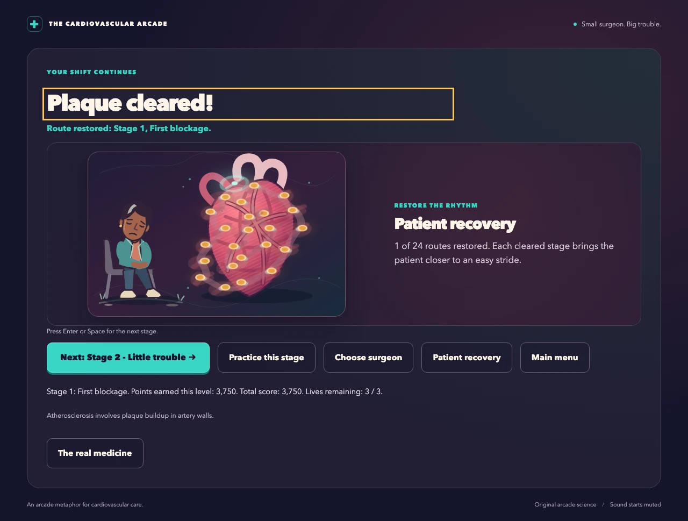
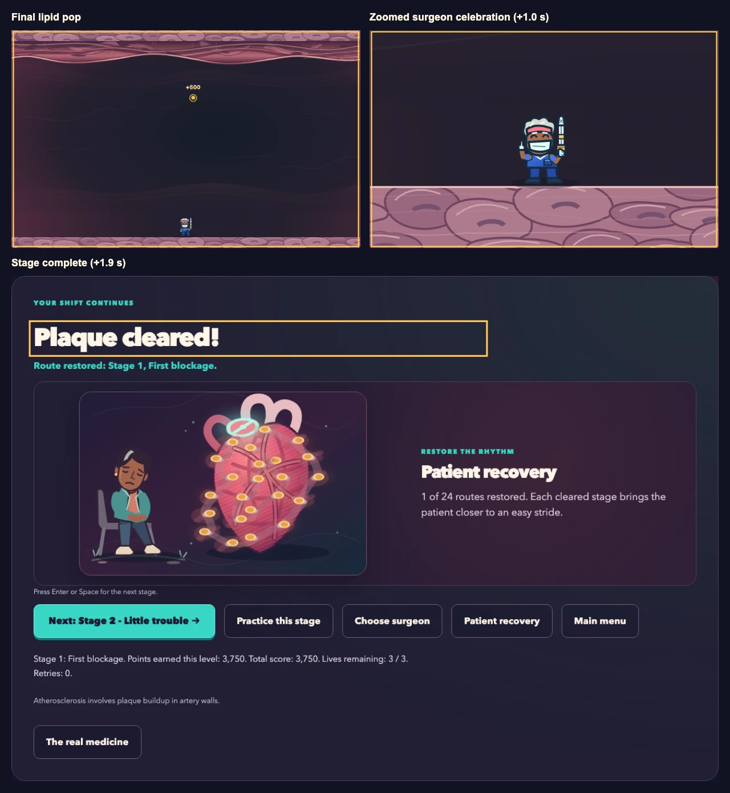

# Clear feedback and continuation

Status: implemented; recovery visibility revision on 2026-10-22. Owner: runtime transition and renderer
contracts below. Scope: keyboard continuation and visible successful-clear feedback in the
existing game.

## Decision and evidence scope

### Recovery after every success

The current result embeds patient recovery directly after the surgeon celebration. This borrows
Bad Cell Day's completion-panel cadence: visible recovery, then a deliberate next-stage action.
The old optional-only recovery presentation below is historical. Detailed route browsing remains
available, while the inline view contains no stage-selection buttons. Practice labels saved
recovery as unchanged; defeat keeps its immediate retry result.

The current capture uses ordinary held-fire input. Focused browser checks cover fresh-key
continuation and save boundaries; temporary fixtures cover consecutive first-five recovery
states, replay, practice, defeat and final completion. Fixtures establish presentation behavior,
not a five-level human playthrough. Evidence is retained in `output/recovery_flow/`.
All 51 source tests and 19 browser tests pass (16 affected journeys plus three dialog checks).
Independent inspection accepts the result presentation and mode boundaries. A landscape finding
was corrected: Next ends at y=369 in an 844 by 390 viewport; portrait Next ends at y=576
in a 390 by 844 viewport. The manager inspected both final captures. These results supersede
the older optional-recovery acceptance below; no deployment or human enjoyment claim is made.

### Earlier transition baseline

Use task analysis and a cognitive walkthrough to inspect the experienced keyboard player's
clear-to-next-stage journey, including a player already holding Space to fire. The requested
outcome is a visible last-lipid pop, a short surgeon celebration, and a clear keyboard path to the
next level. This is expert inspection with automated and browser evidence; no new participant
study has been conducted. Completion time, errors, accidental transitions, and visible closure
are the measures. Human playtesting is optional and does not gate completion.

Pre-change baseline inspected on 2026-10-22: `finish` in [src/main.ts](../src/main.ts) switched
immediately to results and scheduled a newly restored recovery dialog. That could obscure the
last pop and added a mandatory dismissal before continuation. [src/input.ts](../src/input.ts)
cleared gameplay keys when gameplay stopped; its set alone could not prove a physical key had
been released. The implementation contracts below address this baseline.

## Task model and walkthrough

| Step | Player goal and action | Visible cue and expected response | Likely error and recovery |
| --- | --- | --- | --- |
| 1 | Keep firing until the final lipid clears, possibly holding Space. | Last hit and pop remain visible in the arena. | A held shot must never count as a continuation command. |
| 2 | Recognize success and stop reacting to hazards. | A brief surgeon victory response follows the pop; simulation freezes. | No timer, health, position or score changes during celebration. |
| 3 | Understand the result and choose the next stage. | Patient recovery art, the cleared route, result and explicit continuation appear. | Releasing held Space or repeated Enter cannot skip results or briefing. |
| 4 | Press Enter, or release then freshly press Space. | One activation moves to the next briefing; its start action remains distinct. | A held key cannot auto-start the next stage. |
| 5 | Read briefing, then deliberately start. | Another deliberate activation enters play. | Tab and native button activation still reach every alternative. |
| 6 | Inspect recovery or finish the campaign. | Recovery is visible on every success; optional route browsing and final results remain available. | No next-stage shortcut on final campaign or practice results. |

At each step inspect whether the player can identify the goal, find the action, associate the
label with its outcome, and recognize that the action succeeded. A result shortcut is contextual:
it must not capture keys from a dialog, editable field or unrelated focused control. Preserve
native button Enter/Space behavior and dialog focus restoration.

## Implementation contracts

- Runtime owns a short successful-clear presentation interval: approximately 0.3 seconds for the
  final pop, a quick camera close-up, then surgeon victory, with results at approximately 2.2 seconds total.
  Game over retains its existing immediate result path. Durations are design defaults, not
  permanent test thresholds. Freeze the terminal simulation and continue rendering.
- Renderer owns the final-hit visibility and cosmetic victory response: pop first, then a brief
  full-body surgeon close-up and celebratory gesture. The gesture starts after the camera settles.
  This never adds jump input, modifies physics, moves colliders, changes hazard state, or rewards
  extra score. Reduced motion cuts to a static close-up; pause freezes the presentation camera.
- Runtime owns contextual continuation and physical press/release tracking across screen changes.
  Enter is the primary hint; Space is supported after a fresh press. Ignore auto-repeat and
  carried presses. One physical activation causes at most one screen transition.
- Results show patient recovery after every successful stage, following Bad Cell Day's inline
  completion-panel pattern. Highlight the cleared route and offer direct continuation without
  requiring a map-dialog dismissal. Keep detailed route browsing optional.
  Campaign restoration is persisted once; practice shows saved recovery without changing it.
- Interface and art owners preserve compact 16:10 presentation, readable hints, visible focus,
  existing controls and editable source assets. The test owner checks actual browser event order.

## Guideline and acceptance ledger

The ledger distinguishes real browser journeys, renderer fixtures and source inspection.

| Task | Guideline and rationale | Observable acceptance | Evidence/status |
| --- | --- | --- | --- |
| 1-2 | Visible feedback and closure: preserve the action's perceptible outcome. | A captured sequence shows final pop, then victory, then result. | Passed: final visual receipt and inspected montage show normal/reduced-motion first-stage clears. |
| 2 | Separate presentation from game state. | Positions, elapsed time, lives, hazards and score remain fixed across the clear interval. | Source review confirms simulation bypass; browser HUD/pause checks pass. Retained renderer fixture preserves complete deep-frozen state, 36 cases by 79 frames. |
| 3-5 | Keyboard access and platform button conventions, W3C SC 2.1.1. | Enter/fresh Space advance once; native Tab/button actions and modal focus remain usable. | Both real-input clear journeys pass in final 14-test browser run; visual receipt records focus and Tab behavior. |
| 3-5 | Error prevention: one deliberate action has one contextual effect. | Hold Space through clear and release: result stays. Fresh Space: briefing only. Hold/repeat Enter: no second transition. | Retained clear_flow.spec.ts Enter/Space event-order journeys pass. |
| 3 | Recognition and player control: keep success and available actions together. | Successful results display patient artwork and highlight the cleared route without opening a dialog. | Revised recovery acceptance is recorded below; the earlier optional-only view is superseded. |
| 2 | Motion preference, W3C SC 2.3.3 (AAA guidance). | Reduced-motion capture shows static victory without cosmetic motion or flashing. | Passed: normal transforms change; reduced-motion transforms remain identical, confirmed in final capture/report. |
| 6 | Consistent mode boundaries. | Final campaign, replayed route and practice preserve appropriate result actions and save behavior. | Source tests/browser regressions pass for restore-once, defeat/retry and practice persistence. Final-campaign clear action inspected in source and synthetic renderer fixture; no newly completed campaign browser journey claimed. |

The carried-key rule is a project interaction requirement, not a claim that WCAG specifically
requires a given shortcut. Passing these targeted checks does not establish whole-game WCAG
conformance or participant comprehension.

The refreshed montage uses ordinary held-fire play through the actual final collision. Detail
views show the final pop and surgeon celebration before the real result screen.
At 844 by 390, result/briefing primary actions and complete hints fit before optional details.
The medicine action and inline restoration can require scrolling on that short viewport.

## Runnable validation plan

1. Run `npx tsc --noEmit`, `node --import tsx --test 'tests/test_*.mjs'`, and
   `./build_github_pages.sh`. Add meaningful behavior coverage for frozen terminal state and
   contextual continuation rather than asserting exact animation timing or source strings.
2. Run `./run_playwright_tests.sh --build`. The browser test starts a deterministic last-hit
   scenario, holds Space before the clear, records arena/result screenshots and event timing,
   releases Space after results, then freshly presses it. Verify results -> briefing -> play
   requires distinct actions. Repeat with Enter and held repeat events.
3. Traverse results with Tab and activate native actions with Enter and Space. Open recovery and
   another dialog, verify shortcut isolation, close, and verify focus returns to the opener.
   Repeat final-campaign and practice clears, including a replayed already-restored route.
4. Capture normal and reduced-motion clear sequences. Compare terminal state samples before and
   after the clear interval. Check a short viewport for compact result and visible hint/focus.
5. Run measured accessibility inspection on changed controls: accessible names/roles, keyboard
   focus order/visibility and text contrast (4.5:1 normal text; 3:1 large text). Record the actual
   measurements, browser version, artifact paths and source build used. An automated scan alone
   cannot establish focus behavior or the final-pop sequence.
6. Run repository checks with `./check_codebase.sh`. Close this ledger only after the named
   browser, runtime and visual evidence agree; preserve any remaining limitation explicitly.

## Source and evidence ledger

- HCI method: local skill `hic-human-interact-expert/SKILL.md`, workflow steps 2-6; its
  `references/task_selection.md` selects task analysis plus cognitive walkthrough for this decision.
  `references/testing_and_oracles.md` requires task completion, guideline and measured
  accessibility evidence. Read from
  `/Users/vosslab/nsh/vosslab-skills/skills/experts/hic-human-interact-expert/` on 2026-10-22.
- Local-book limitation: `references/local_books.md` names a `references/local-only/` corpus, but
  that directory and the named book files are absent in the repository skill, installed skills
  and targeted filename search across `~/.codex` and `~/nsh`. No local-book passage or line evidence
  is claimed. The skill's documented corpus-absent route applies.
- Primary guidance checked 2026-10-22: [W3C keyboard guidance](https://www.w3.org/WAI/WCAG22/Understanding/keyboard.html),
  lines 30-53, supports keyboard equivalents and native button conventions;
  [W3C motion guidance](https://www.w3.org/WAI/WCAG22/Understanding/animation-from-interactions.html),
  lines 30-53, supports disabling nonessential interaction motion. These guidelines do not select
  a celebration duration; the proposed duration remains a project decision.
- Current implementation evidence (2026-10-22): `./check_codebase.sh` passed with 47 source tests;
  `./build_github_pages.sh` passed. Logs are `/private/tmp/plaque_clear_checks.log` and
  `/private/tmp/plaque_clear_build.log`. Documentation ASCII, local-link and guidance-format
  checks passed; the manager's broader documentation run passed 224 tests. Final full browser
  rerun passed all 14 tests after the compact-layout correction. Retained logs are
  `output/clear_flow/code_checks.log`, `output/clear_flow/build_final.log` and
  `output/clear_flow/browser_final.log`. Source specification review passed in
  `output/clear_flow/spec_review.md`.
- Visual review found result actions and keyboard hints below the fold at 844 by 390. The compact
  layout now places primary actions and complete hints ahead of optional detail. Fresh normal and
  reduced-motion captures and measurements are in `output/clear_flow/visual/receipt.json`, using
  Chromium 156.0.8078.4; hashes before and after capture match, with no browser errors.
  `output/clear_flow/visual/acceptance.md` records successful actual normal/reduced clears, focus,
  names, pause stability and compact primary-task visibility. Targeted text contrast is at least
  6.73:1; focus contrast is 9.00:1. These measurements cover the changed cues rather than a full
  WCAG or screen-reader audit. Fresh quality recheck passed with no blockers in
  `output/clear_flow/final_quality.md`. Final integration accepted with no blockers in
  `output/clear_flow/integration.md`, verifying source maps, source/dist assets and capture build
  identity. Acceptance covers the declared inspection and automated scenarios; it does not claim
  deployment, a participant study or newly played full-campaign completion.
- `output/clear_flow/visual/immutable_fixture_receipt.json` retains 36 renderer cases, each over
  79 frames, across six surgeons, both motion preferences and campaign/practice/final terminal
  states. Each preserves complete deep-frozen state and draws the matching victory asset. The
  final-campaign state is synthetic; this is renderer proof, not a newly played full campaign.
- Final evidence build: `dist/main.js` SHA-256
  `09f4eab57277fc69dffef7a9c0de54f3982b6d1bcb5a5b6ddf50b8e3e7a178a8`;
  `dist/style.css` SHA-256
  `7e18b2e3130cc9b9e6a84185b2ac954a8e5b9225ab70ba2f930093a64446a675`.
