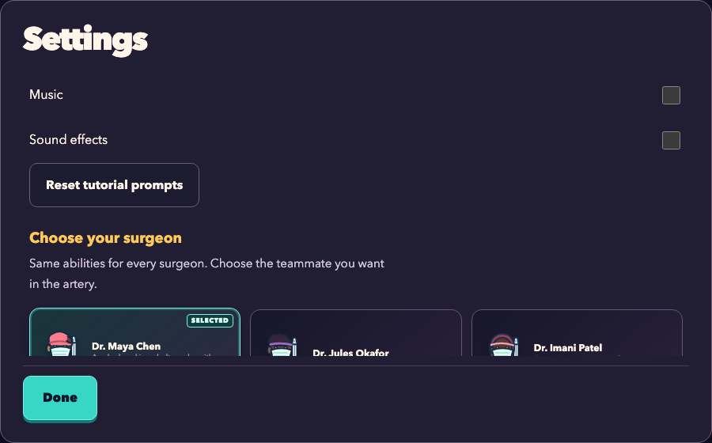

# Compact dialog layout

The arena stays at a 16:10 presentation ratio. Popups now share a compact frame with a fixed
heading and action row around scrolling content. Desktop dialogs can use 900px of width and
a default 560px height cap; short landscape uses the available height with viewport gutters.
Recovery retains its
specialized wider map. Phone dialogs prioritize readable text rather than a fixed aspect ratio.

## Measured improvement

At 1280x800, Settings previously measured 560x760, with the bottom of Done at y=906.6. The medicine
panel also measured 560x760, with Close ending at y=1379.0. Both now measure 900x560, with their
footer action ending at y=651.0. Long content remains available by scrolling inside the frame.

The screenshot intentionally shows content continuing below the scrolling region; the heading
and Done remain outside that region. Settings, pause, instructions, medicine, high scores,
surgeon selection and patient recovery all use the shared action footer.

## Verification

- Browser capture covers 1280x800, 844x390, 390x844 and 320x568. All 28 measured dialog actions
  fit in the viewport; the arena ratio remains 1.6 at all four sizes.
- Three durable browser tests verify fixed heading/action positions during content scrolling,
  keyboard traversal and activation, accumulated Settings messages, pause/resume, and 16:10
  gameplay. They use actual controls and no injected simulation state.
- The initial test incorrectly assumed reverse Tab from a non-tabbable heading would focus the
  last action. It now checks ordinary forward Tab traversal instead; production keyboard behavior
  was not changed to satisfy that assumption.
- All 47 source tests, 17 browser journeys and 226 documentation checks pass. The Pages build
  succeeds. These are local results; the updated game has not been deployed.
- Screenshots and before/after measurements are retained in ignored `output/dialog_fit/`.

## Implementation references

[dialogs.ts](../src/dialogs.ts) owns the shared heading/content/footer structure;
[main.ts](../src/main.ts) places each action explicitly; [style.css](../src/style.css) owns
viewport constraints and flex sizing. Chooser-specific wrappers and footer rules were removed.

The local CSS skill's `A_Complete_Guide_to_CSS_Flexbox-2026.md` background and axis section
(lines 36-65) informed the layout. Shrinking scrollable content follows the
[CSS Flexbox minimum-size model](https://drafts.csswg.org/css-flexbox-1/#min-size-auto), with
explicit zero minimum height as described by [MDN min-height](https://developer.mozilla.org/en-US/docs/Web/CSS/Reference/Properties/min-height).
