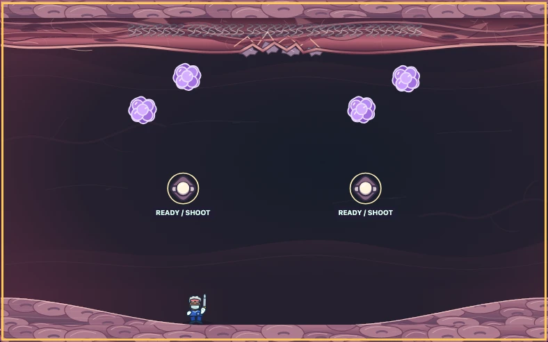
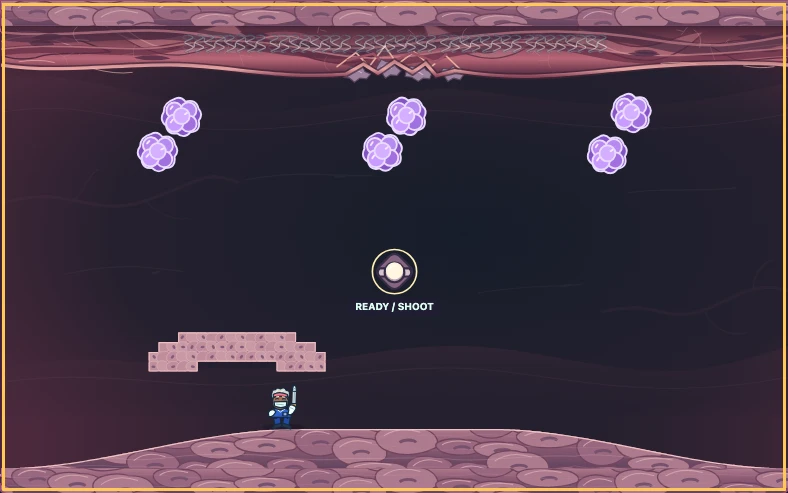
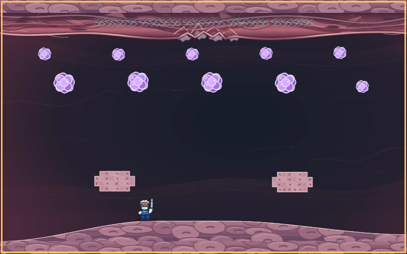

# Floor variation review

The earlier floor system correctly followed smooth terrain, but reused shallow waves and one
rounded central rise. This update gives later stages three more readable silhouettes without
adding jumping, sliding, movement penalties or additional controls.

## Implemented terrain

| Shape | Stages | Positioning difference |
| --- | --- | --- |
| Basin | 10, 23 | Broad low center between raised outer positions |
| Shelf | 14, 24 | Broad raised center with lower outer positions |
| Shoulder | 17 | Offset raised platform with unequal flanks |

These profiles preserve the 48-pixel relief ceiling and 0.20 maximum slope. Stages 1-6 and flat
weapon introductions retain their existing geometry. A surface highlight follows the actual
collision contour; the clipped cellular texture and shading remain inside the solid floor.

Floor height changes feet, muzzle height, clearance below tissue and the local hazard orbit.
Since hazards also follow the floor envelope, high ground does not automatically confer safety.
The shapes establish spatial variety; automated completion does not prove a preferred human
strategy or that each shape is more enjoyable.

## Actual game captures

These refreshed captures use the built app at 1280x800, a synthetic unlock solely to access Practice,
and normal keyboard movement. Canvas screenshots preserve the 16:10 presentation. They do not
alter terrain, artwork, hazard state or player position directly.

Inspection confirms distinct contours, a visible cellular surface, readable hazards and the
surgeon's feet supported at the edge of the slope. Background and floor remain visually distinct.

## Verification

- All 24 layouts pass exhaustive footprint samples and slope/height bounds, controlled traversals
  checking feet and muzzle, and four target sizes through 2,400 motion steps each.
- State-aware movement/fire simulations clear stages 10, 14, 17, 23 and 24 with three lives intact
  using seed 1729. These are five independent Practice runs, not a full campaign replay or proof
  across every seed. Maintenance finishes with its permitted remaining hazards.
- All three new terrain briefings keep Start stage fully visible at 844x390; gameplay canvases
  retain 16:10. Captures report no browser errors.
- All 47 source tests, 14 browser journeys and 225 documentation checks pass; the Pages build
  succeeds. This is local verification, not deployment. Detailed captures, source hashes,
  input traces, geometry results and generated difficulty measurements are in ignored
  `output/floor_variation/`.

Canonical definitions remain in [arena_layouts.ts](../src/arena_layouts.ts); all consumers use
[arena_geometry.ts](../src/arena_geometry.ts). See [STAGE_MECHANICS_PLAN.md](STAGE_MECHANICS_PLAN.md)
for stage placement and [DIFFICULTY_RUBRIC.md](DIFFICULTY_RUBRIC.md) for measurement limits.
